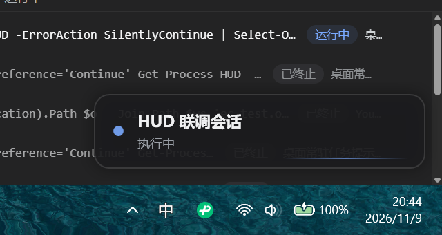
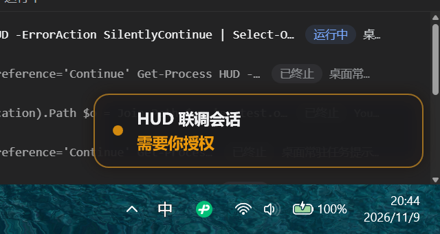
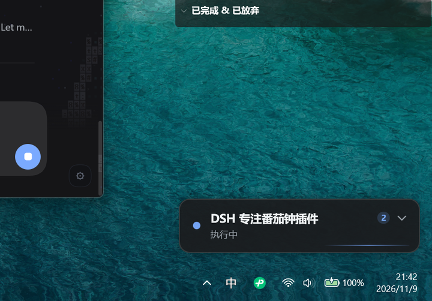
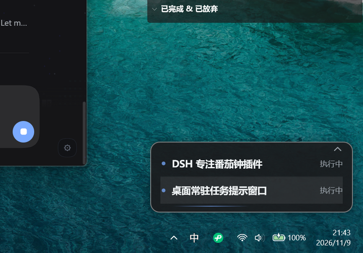

# DSH Desktop HUD

<p>
  
  
  
  
</p>

**An always-on-top desktop card for [DeepSeek Harness](https://deepseek-harness.github.io/) (DSH).** It shows what DSH is doing — running turns, approval requests, questions waiting for you, finished tasks and errors — without making you switch back to the main window.

<p align="center">
  
  
</p>

When DSH is idle the card collapses into a tiny pill (`● DSH 空闲`) in the bottom-right corner of your primary display. When a turn starts it expands into a card with the session title. When something needs *you* — an approval prompt or a question — it draws an amber (approval) or blue (question) pulse, and one click brings DSH back to the front.

> The card's status text is currently Chinese (`执行中`, `需要你授权`, …). Localization is on the roadmap; file an issue if you need another language first.

## Features

- **Two shapes, no clutter** — an idle pill, or a card while something is running. Same anchor point, topmost, hidden from the taskbar, never steals focus.
- **Six at-a-glance states** with distinct colors and animations:

  | State | Card shows | Look |
  |---|---|---|
  | Idle | `● DSH 空闲` pill | dimmed pill, minimal footprint |
  | Running | session title + `执行中` | blue breathing dot + shimmer line |
  | Approval needed | session title + `需要你授权` | amber border pulse + outer glow |
  | Question waiting | session title + `需要你回答` | blue highlight |
  | Turn completed | `✓ 任务完成` | green flash, collapses after 15 s |
  | Error | session title + `出错了` | red, stays until the next turn starts |

- **Multi-session task list** — run several sessions at once? The card gets a count badge and a `⌄` chevron. Expand it to see up to 4 tasks stacked vertically (extra ones collapse into a `+N 个任务` row). Child agents and workflows are folded into the session that owns them, so internal traffic never floods the list.

  <p>
    
    
  </p>

- **Click to return** — click the card (or any task row) and DSH is restored from the taskbar and focused. Drag to move it anywhere; the position is remembered per user. Right-click for *Focus DSH / Hide for 30 minutes / Quit HUD*.
- **Side-channel only** — the plugin observes events and never participates in the approval flow. A 600 ms debounce means auto-approved requests don't flash on screen. If anything goes wrong, the HUD simply stops updating; DSH is unaffected.
- **No runtime, no network, no admin** — the overlay is a prebuilt C# WPF executable (`.NET Framework 4.8`, bundled). The host plugin has zero npm dependencies; it writes one small JSON file that the overlay reads.

## Requirements

| | |
|---|---|
| OS | Windows 10 or 11, x64 |
| Runtime | .NET Framework 4.8 (included in Windows 10/11 — nothing to install) |
| DSH | DeepSeek Harness `0.2.x` (tested against `0.2.2-rc.1`) |
| Display | any; the card anchors to the primary display bottom-right |

macOS and Linux are not supported: the overlay is a Windows WPF window.

## Install

```bash
dsh plugin --profile desktop add github:D00023/dsh-plugin-desktop-hud
```

Replace `desktop` with the profile you actually use (`dsh plugin --help` shows the flag). DSH will ask you to restart the app — the HUD appears once the plugin is loaded, pinned to the bottom-right of your primary display.

Prefer a local checkout?

```bash
git clone https://github.com/D00023/dsh-plugin-desktop-hud.git
dsh plugin --profile desktop add ./dsh-plugin-desktop-hud
```

Uninstall:

```bash
dsh plugin --profile desktop remove dsh-plugin-desktop-hud
```

...then restart DSH. Quit the HUD window first (right-click → *退出小窗*) if you want it gone immediately.

## Usage

| Action | Result |
|---|---|
| Left-click the card / a task row | Bring DSH to the front (restores it if minimized) |
| `⌄` / `⌃` (appears when ≥ 2 tasks) | Expand / collapse the task list |
| Drag | Move the card; position is saved to `%LOCALAPPDATA%\dsh-desktop-hud\window-v1.json` |
| Right-click | *回到 DSH* / *隐藏 30 分钟* / *退出小窗* |
| Hover | Border brightens, so you know it's clickable |

If you choose *退出小窗*, the HUD stays hidden until DSH restarts — that's intentional, so it can't come back while you're trying to get rid of it.

## How it works

```
DSH host plugin (Cordis)                       HUD.exe (C# WPF)
──────────────────────────────                 ──────────────────────────
listens:  agent/status                                        reads on start,
          approval/request     ──writes──▶  state.json  ──▶  then FileSystemWatcher
          user-questions/request    (atomic, v3, 2 s heartbeat)  + 400 ms polling
          agent/error
          session/event                                   renders pill/card,
maintains a per-session state machine;                     animations, task list,
writes one state file and keeps it fresh                    focus DSH, position
                                                            memory, quit marker
```

- The host plugin derives a single ordered `tasks` array (per root session, sorted by urgency, then recency) and writes it atomically (`*.tmp` + rename, with retries). A heartbeat re-writes the file every 2 s.
- The overlay picks the file up, renders it, and reacts to interactions. If the file stops updating for 10 s (DSH quit, plugin disabled, crash) the overlay exits by itself — no orphan windows.
- State file and exit marker live in `%LOCALAPPDATA%\dsh-desktop-hud\`. A `bye` marker written by the overlay stops the plugin from respawning it for the rest of the session.
- Everything is local to your machine. No network calls, no elevated permissions, no external processes besides `HUD.exe`.

The wire format is documented in [`PROTOCOL.md`](PROTOCOL.md); visual parameters are in [`overlay/UI-SPEC.md`](overlay/UI-SPEC.md).

## Development

```bash
# pure-logic state machine (16 tests)
node test/state.test.mjs

# state-file bridge + overlay supervision (8 tests)
node test/bridge.test.mjs

# rebuild the overlay from source (no .NET SDK needed — uses the C# compiler
# that ships with .NET Framework 4.8 and references the GAC assemblies)
powershell -NoProfile -ExecutionPolicy Bypass -File overlay/build.ps1

# preview states without DSH
overlay/bin/HUD.exe --demo                 # cycles all six states
overlay/bin/HUD.exe --demo --state=attention
overlay/bin/HUD.exe --demo-multi           # 2/3/6-task samples
overlay/bin/HUD.exe --state-file "%LOCALAPPDATA%\dsh-desktop-hud\state.json"
```

Repository layout:

```
index.js            Cordis host plugin: event listeners → state machine → file bridge
hud-state.js        pure multi-session state machine (no Cordis imports)
hud-bridge.js       atomic state-file writer, heartbeat, overlay supervision, quit marker
cordis.patch.yml    bundle patch that installs the plugin row
locale/             plugin-manager strings (en / zh)
overlay/src/*.cs    HUD.exe sources: WPF window, XAML, JSON, Win32 interop, state-file client
overlay/HudWindow.xaml
overlay/bin/HUD.exe prebuilt overlay (checked in — git installs don't build)
overlay/build.ps1   csc-based build script
overlay/UI-SPEC.md  visual spec, colors, spacing, animations
PROTOCOL.md         state-file protocol v3
docs/images/        screenshots used by this README
```

Contributions are welcome. Keep the host side free of npm dependencies, run both test files, and state in the PR whether the overlay changed (then include a rebuilt `overlay/bin/HUD.exe`).

## Troubleshooting

| Symptom | What to check |
|---|---|
| Card never appears | `%LOCALAPPDATA%\dsh-desktop-hud\hud.log` (plugin lifecycle log, rotated at 256 KB). `overlay started pid=…` means the plugin launched it. You can also run `overlay\bin\HUD.exe --state-file "%LOCALAPPDATA%\dsh-desktop-hud\state.json"` by hand. |
| Card visible but frozen | `state.json`'s `ts` should change every 2 s. If it doesn't, the host plugin isn't running (or was disabled). |
| Just updated the plugin | Restart DSH; plugin code is only reloaded at startup. |
| Card vanished after *退出小窗* | Intended. Restart DSH to bring it back. |
| Card in a strange spot | It was dragged there. Drag it back, or delete `window-v1.json` while the HUD is closed. |
| Two identical cards | Fixed in **v1.0.1**. Older versions could be mounted twice by DSH and spawn two overlays. Update the plugin: the overlay now holds a per-state-file named mutex (a second instance exits with code 42 without drawing), and the host half reuses a live bridge instead of creating another. `hud.log` records `duplicate apply detected` when DSH does try twice. |

## Known limitations

- Primary display only — no per-monitor position memory yet.
- The outer glow is slightly larger than the window's transparent padding, so the shadow is clipped by ~1 px at the window edge (cosmetic).
- Requires write access to `%LOCALAPPDATA%\dsh-desktop-hud\`. Without it you lose position memory and the quit marker, but state notifications still work.
- The HUD does **not** offer approve/deny buttons on purpose: decisions stay in the DSH window, where the full context is visible.
- No sound or Windows toast notifications by design (visual only).

## License

[MIT](LICENSE) © 2026 D00023

---

**中文版 / Chinese:** [README.zh-CN.md](README.zh-CN.md)