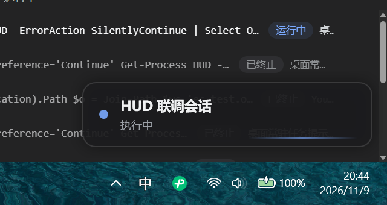
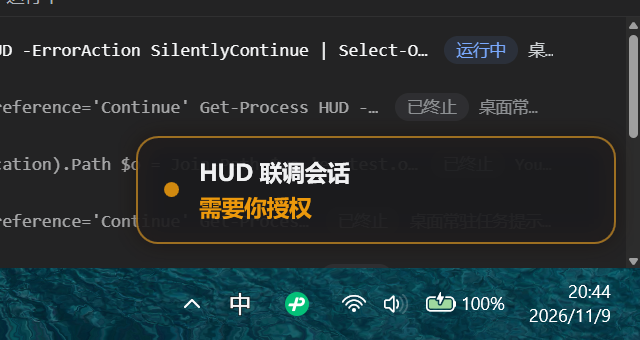
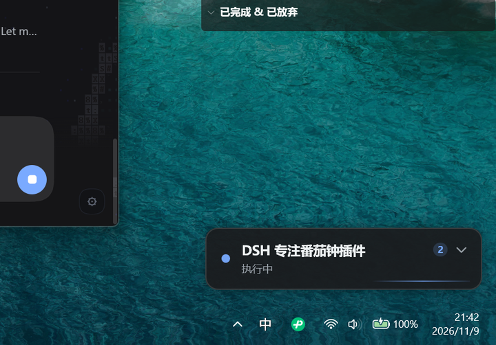
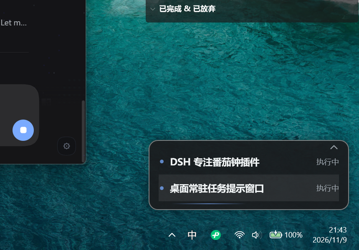

# DSH 桌面状态小窗

<p>
  
  
  
  
</p>

**为 [DeepSeek Harness](https://deepseek-harness.github.io/)（DSH）准备的桌面常驻小窗。** 你不用反复切回主窗口，就能看到 DSH 正在做什么——正在执行的任务、等待你处理的授权、等待你回答的问题、刚完成的任务，以及报错。

<p align="center">
  
  
</p>

DSH 空闲时，小窗缩成右下角一颗小胶囊（`● DSH 空闲`）；任务开始时展开成卡片并显示会话标题。一旦有**需要你处理**的事——授权请求或提问——卡片会用琥珀色（授权）/ 蓝色（提问）脉冲提醒你，点一下就能把 DSH 主窗口拉到前台。

## 功能

- **两种形态，不占地方**：空闲时是小胶囊，有任务时展开成卡片。同一锚点、始终置顶、不显示在任务栏、不抢焦点。
- **六种一眼可辨的状态**：

  | 状态 | 卡片显示 | 视觉 |
  |---|---|---|
  | 空闲 | `● DSH 空闲` 胶囊 | 半透明胶囊，几乎不占地方 |
  | 运行中 | 会话标题 + `执行中` | 蓝点呼吸 + 底部流光 |
  | 需要授权 | 会话标题 + `需要你授权` | 琥珀色描边呼吸 + 外发光脉冲 |
  | 需要回答 | 会话标题 + `需要你回答` | 蓝色高亮 |
  | 任务完成 | `✓ 任务完成` | 绿色脉冲一次，15 秒后收回胶囊 |
  | 出错了 | 会话标题 + `出错了` | 红色，保留到下一次任务开始 |

- **多任务并发显示**：同时跑多个会话时，卡片右上角出现**任务数徽标**和 `⌄` 按钮，点开后向上展开任务列表——最多 4 行，多余的折叠为 `+N 个任务`。子代理、工作流的忙碌会归并到所属会话，不会把列表刷满。

  <p>
    
    
  </p>

- **点一下回到 DSH**：点卡片（或任意任务行）会把 DSH 从任务栏还原并聚焦。卡片可自由拖动，位置按用户记住。右键菜单：*回到 DSH / 隐藏 30 分钟 / 退出小窗*。
- **纯旁路，不干扰 DSH**：插件只观察事件，绝不参与审批流程；授权提醒有 600ms 防抖，被策略自动放行的请求不会闪你一下。任何异常只会让小窗停止更新，不会影响 DSH 本身。
- **零运行时、零联网、零管理员权限**：小窗是预编译好的 C# WPF 程序（.NET Framework 4.8，系统自带），Host 插件没有任何 npm 依赖——它只写一个很小的 JSON 状态文件，小窗负责读和画。

## 环境要求

| | |
|---|---|
| 系统 | Windows 10 / 11，x64 |
| 运行时 | .NET Framework 4.8（Win10/11 自带，无需安装） |
| DSH | DeepSeek Harness `0.2.x`（在 `0.2.2-rc.1` 上验证） |
| 显示 | 任意；卡片锚定在主屏右下角 |

macOS / Linux 不支持：小窗是 Windows WPF 窗口。

## 安装

```bash
dsh plugin --profile desktop add github:D00023/dsh-plugin-desktop-hud
```

把 `desktop` 换成你实际使用的 profile（`dsh plugin --help` 里有说明）。DSH 会提示你重启，重启后插件生效，小窗出现在主屏右下角。

想用本地源码安装：

```bash
git clone https://github.com/D00023/dsh-plugin-desktop-hud.git
dsh plugin --profile desktop add ./dsh-plugin-desktop-hud
```

卸载：

```bash
dsh plugin --profile desktop remove dsh-plugin-desktop-hud
```

然后重启 DSH。想立刻关掉小窗，先右键 → *退出小窗*。

## 使用

| 操作 | 效果 |
|---|---|
| 左键点卡片 / 任务行 | 回到 DSH（最小化会先还原并聚焦） |
| `⌄` / `⌃`（任务数 ≥ 2 时出现） | 展开 / 收起任务列表 |
| 拖动 | 移动小窗，位置保存到 `%LOCALAPPDATA%\dsh-desktop-hud\window-v1.json` |
| 右键 | *回到 DSH* / *隐藏 30 分钟* / *退出小窗* |
| 悬停 | 边框微亮，提示可点击 |

在右键菜单里选了 *退出小窗* 后，本次 DSH 运行期间它不会再自动出现——这是故意的，免得你关不掉它。

## 工作原理

```
DSH Host 插件（Cordis）                        HUD.exe（C# WPF）
──────────────────────────────                 ──────────────────────────
监听：  agent/status                                       启动时读取，
        approval/request    ──原子写──▶  state.json  ──▶  之后 FileSystemWatcher
        user-questions/request      （v3 协议，2s 心跳）      + 400ms 轮询
        agent/error
        session/event                                  渲染胶囊/卡片、动画、
维护按会话的状态机；写一个状态文件并              任务列表、聚焦 DSH、位置记忆、
持续刷新它                                        退出标记
```

- 插件按「根会话」汇总出排好序的 `tasks` 数组（按紧急程度、再按最近活跃排序），原子写入（`*.tmp` + rename，带重试），每 2 秒心跳刷新一次。
- 小窗读取并渲染；文件 10 秒不更新（DSH 退出 / 插件被禁用 / 崩溃）时小窗自行退出，不留孤儿窗口。
- 状态文件与退出标记都在 `%LOCALAPPDATA%\dsh-desktop-hud\`。小窗写入的 `bye` 标记会让插件在本次运行内不再重新拉起它。
- 全部在本机完成：不联网、不需要提权、除 `HUD.exe` 外不启动任何外部进程。

协议格式见 [`PROTOCOL.md`](PROTOCOL.md)，视觉参数见 [`overlay/UI-SPEC.md`](overlay/UI-SPEC.md)。

## 开发

```bash
# 纯逻辑状态机（16 个测试）
node test/state.test.mjs

# 状态文件桥 + 小窗进程守护（8 个测试）
node test/bridge.test.mjs

# 从源码重新编译小窗（无需 .NET SDK：用 Windows 自带的 .NET Framework 4.8
# C# 编译器，并引用 GAC 程序集）
powershell -NoProfile -ExecutionPolicy Bypass -File overlay/build.ps1

# 不启动 DSH 也能预览
overlay/bin/HUD.exe --demo                 # 轮播六种状态
overlay/bin/HUD.exe --demo --state=attention
overlay/bin/HUD.exe --demo-multi           # 2/3/6 任务的样例
overlay/bin/HUD.exe --state-file "%LOCALAPPDATA%\dsh-desktop-hud\state.json"
```

仓库结构：

```
index.js            Cordis Host 插件：事件监听 → 状态机 → 文件桥
hud-state.js        纯多会话状态机（不 import Cordis）
hud-bridge.js       状态文件原子写、心跳、小窗进程守护、退出标记
cordis.patch.yml    安装插件行的 bundle patch
locale/             插件管理器的界面文案（en / zh）
overlay/src/*.cs    HUD.exe 源码：WPF 窗口、XAML、JSON、Win32 互操作、状态文件客户端
overlay/HudWindow.xaml
overlay/bin/HUD.exe 预编译小窗（已入库——git 安装不会跑 build）
overlay/build.ps1   基于 csc 的编译脚本
overlay/UI-SPEC.md  视觉规范（颜色、间距、动画）
PROTOCOL.md         状态文件协议 v3
docs/images/        README 用到的截图
```

欢迎提 Issue / PR。Host 侧请保持零 npm 依赖，提 PR 前跑两个测试文件；如果改了 overlay 源码，请把重新编译的 `overlay/bin/HUD.exe` 一起提交。

## 排障

| 现象 | 排查 |
|---|---|
| 小窗始终没出现 | 看 `%LOCALAPPDATA%\dsh-desktop-hud\hud.log`（插件生命周期日志，256KB 轮转）。有 `overlay started pid=…` 说明插件已成功拉起；也可以手动运行 `overlay\bin\HUD.exe --state-file "%LOCALAPPDATA%\dsh-desktop-hud\state.json"` |
| 小窗在但状态不更新 | `state.json` 的 `ts` 应每 2 秒变化；不变说明 Host 插件没在跑（或被禁用） |
| 刚更新过插件 | 重启 DSH；插件代码只在启动时加载 |
| 选了「退出小窗」后不见了 | 这是预期行为，重启 DSH 才会恢复 |
| 小窗位置奇怪 | 被拖动过。拖回去，或在关闭小窗后删除 `window-v1.json` |
| 同时出现两个一模一样的小窗 | **v1.0.1 已修复**。旧版本可能被 DSH 重复挂载两次、拉起两个小窗。更新插件即可：现在 HUD.exe 按状态文件路径持命名互斥体（第二个实例直接以退出码 42 退出、不画窗口），Host 端也会复用已存在的桥而不是再建一个；DSH 真的重复挂载时 `hud.log` 会记录 `duplicate apply detected` 及调用栈 |

## 已知限制

- 只支持主屏（多显示器的逐屏位置记忆尚未实现）。
- 外发光比窗口透明边距略大，窗口边缘的阴影有约 1px 裁切（仅影响观感）。
- 需要能写 `%LOCALAPPDATA%\dsh-desktop-hud\`；写不进时只是不记忆位置/不记忆退出选择，状态提示仍正常。
- 小窗上**故意**不提供「批准 / 拒绝」按钮：决策留在 DSH 主窗口里，那里能看到完整上下文。
- 按设计不发声、不发 Windows 系统通知（纯视觉提醒）。

## 许可证

[MIT](LICENSE) © 2026 D00023

---

**English:** [README.md](README.md)